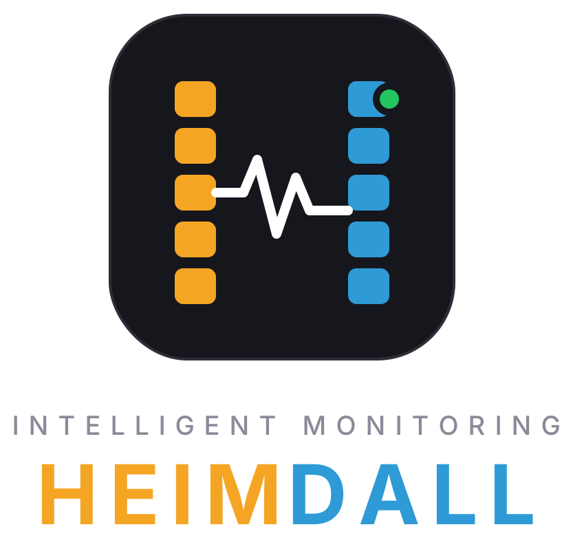
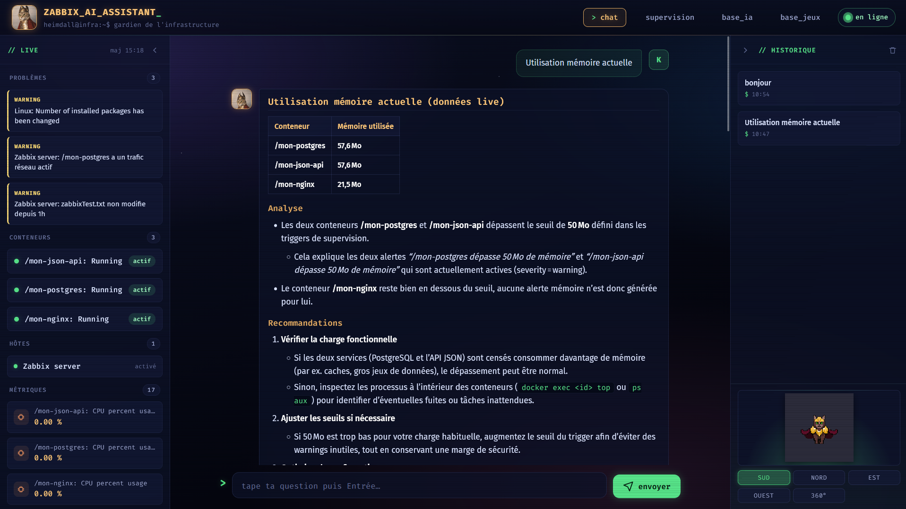
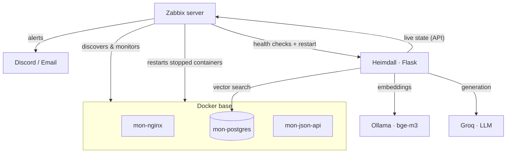
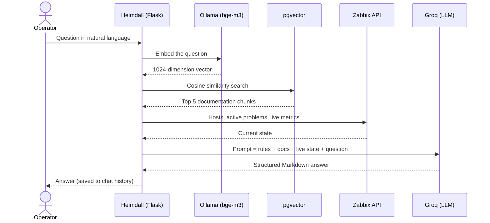

<div align="center">



**Intelligent monitoring for a Docker infrastructure.**
*It detects incidents, fixes them, explains them in plain language, and watches over itself.*


</div>

---

## Table of contents

- [Overview](#overview)
- [What makes it special](#what-makes-it-special)
- [Screenshots](#screenshots)
- [Architecture](#architecture)
- [How the assistant answers](#how-the-assistant-answers)
- [Self-healing](#self-healing)
- [Tech stack](#tech-stack)
- [Repository structure](#repository-structure)
- [Getting started](#getting-started)
- [Usage](#usage)
- [Demo scenario](#demo-scenario)
- [Lessons learned](#lessons-learned)
- [Limitations and roadmap](#limitations-and-roadmap)
- [Security](#security)
- [Context](#context)

---

## Overview

Classic monitoring is good at **collecting**: it raises alerts when something breaks. It usually stops there. Nothing gets fixed automatically, and the information stays locked in dashboards that only specialists can read.

Heimdall goes further. It is built as a stack of five layers on top of a Docker base:

1. **Discover**: Zabbix finds the containers on its own and starts monitoring them.
2. **Alert**: incidents are pushed to Discord and email.
3. **Fix**: a stopped container is restarted with no human involved.
4. **Explain**: an AI assistant answers questions about the infrastructure in natural language, grounded in live data.
5. **Watch itself**: Zabbix monitors the assistant's health and restarts it if it fails.

> Heimdall is the guardian of the gods in Norse mythology, the one who sees everything. Here, he guards the infrastructure.

---

## What makes it special

**🔁 A monitoring loop that closes on itself.** Layer 5 monitors the assistant from layer 4. Ask Heimdall *"how are you monitored?"* and it describes its own supervision, because that documentation is part of its knowledge base.

**🧠 Two separate sources of truth.** The assistant never guesses the state of the system. *How things work* comes from the project documentation (RAG). *What is happening right now* comes from the Zabbix API, live. This split keeps it from inventing incidents that don't exist.

**🔒 Embeddings stay local.** Documents are vectorised by `bge-m3` running on Ollama on the machine itself. The documentation is never sent to a third party for indexing; only the final prompt goes to the LLM.

**🔄 Model-agnostic by design.** The LLM is set by one environment variable (`CHAT_MODEL`). When Groq retired `llama-3.3-70b-versatile` in August 2026, the switch to `openai/gpt-oss-120b` took a one-line change and zero code changes.

**🧪 Every layer is testable on its own.** Each layer was built, tested, and validated before the next one started. A failure can be traced to a single layer.

**🛑 A shutdown that doesn't fight its own self-healing.** `stop-session.sh` stops Zabbix *first*, so the remediation can't restart the very services you are shutting down.

**🎮 A personal interface.** A web UI with a live sidebar, a monitoring view, a knowledge-base browser, chat history, and an animated pixel-art mascot you can rotate.

---

## Screenshots

<p align="center">
  
  <br>
  <em>Heimdall answering with live Zabbix data, next to the live sidebar of problems, containers and metrics.</em>
</p>

---

## Architecture

| Layer | Role | Technologies |
|---|---|---|
| **Base** | Three monitored services: web, database, API | Docker (`mon-nginx`, `mon-postgres`, `mon-json-api`) |
| **1. Discovery** | Automatic detection of containers, PostgreSQL monitoring | Zabbix LLD, Zabbix agent 2 |
| **2. Notifications** | Incident alerts on two channels | Discord webhook, SMTP email |
| **3. Self-healing** | Restarts a stopped container | Zabbix action + Bash script |
| **4. AI assistant** | Natural-language answers, web interface | Flask, RAG (pgvector + bge-m3), Groq, Nginx |
| **5. Self-monitoring** | Watches the assistant's health and restarts it | Zabbix web scenario + Bash script |



**Design choice: Flask runs natively, not in a container.** The assistant depends on Ollama, which uses the host GPU. Running it natively kept it simple, and it is monitored through HTTP health checks instead of Docker discovery.

---

## How the assistant answers



**Why RAG?** The model knows nothing about this infrastructure. Retrieval gives it a searchable memory: update a Markdown file, re-run the ingestion, and the knowledge is available immediately, with no retraining. Retrieving only the 5 most relevant chunks keeps the prompt small and focused, instead of flooding it with the whole documentation.

**The knowledge base** lives in `assistant-ia/mdFiles/`:

| File | Content |
|---|---|
| `01_infrastructure.md` | Containers, WSL, databases |
| `02_supervision_zabbix.md` | Templates, items, triggers, discovery |
| `03_alertes_remediation.md` | Discord, email, Docker self-healing |
| `04_procedures.md` | Everyday commands and debugging |
| `05_assistant_ia.md` | Assistant architecture, model choice, RAG |
| `06_interface_web.md` | Web interface and reverse proxy |
| `07_supervision_flask.md` | Self-monitoring (layer 5) |

---

## Self-healing

### Layer 3: Docker containers

- **Trigger**: a container's `state.running` item reports it is down.
- **Action**: runs the Zabbix script `Restart container`, which calls `zbx-restart-container.sh "{TRIGGER.NAME}"`.
- **Result**: the container is restarted, Discord and email are notified, and the event is logged to syslog with the `zbx-remediation` tag.

### Layer 5: the assistant itself

- **Web scenario** `Flask Heimdall health`: 4 steps every minute, each expecting HTTP 200.

  | Endpoint | Checks |
  |---|---|
  | `/health/db` | PostgreSQL connection |
  | `/health/ollama` | Local embedding model |
  | `/health/groq` | LLM provider |
  | `/health/zabbix` | Zabbix API |

- **Trigger**: `last(/Zabbix server/web.test.fail[Flask Heimdall health])>0`, severity High.
- **Action**: runs `Restart Flask` (`zbx-restart-flask.sh`). Recovery is announced on Discord and by email.
- **Script details** that make it robust when Zabbix runs it non-interactively:
  - calls the virtualenv's Python directly, without `source activate`
  - fully detaches the process: `setsid nohup ... </dev/null >/tmp/flask.log 2>&1 &`
  - waits up to 30 seconds on `/health/db`, to cover the ~9 second warm-up of `bge-m3`

---

## Tech stack

| Component | Role |
|---|---|
| **Zabbix 7.0 LTS** | Monitoring, alerting, remediation |
| **Docker** | Containerised services |
| **PostgreSQL + pgvector** | Project data and vector store |
| **Python / Flask** | Assistant backend and web interface |
| **Ollama + bge-m3** | Local embeddings (1024 dimensions) |
| **Groq · openai/gpt-oss-120b** | Answer generation |
| **Nginx** | Reverse proxy |
| **Ubuntu 24.04 on WSL2** | Host environment (GTX 1660 Ti, 3.8 GB RAM for WSL) |

---

## Repository structure

```
heimdall/
├── assistant-ia/
│   ├── app.py                       Flask app: chat, health checks, Zabbix and RAG calls
│   ├── ingest.py                    Splits, embeds and stores the documentation
│   ├── rechercher_documentation.py  Vector search
│   ├── ask.sh                       Command-line helper
│   ├── requirements.txt
│   ├── .env.example                 Configuration template (no secrets)
│   ├── mdFiles/                     Knowledge base used by the RAG
│   ├── nginx/heimdall.conf          Reverse proxy configuration
│   └── static/                      Web interface and pixel-art mascot
├── json-api/                        Fictional video-game dataset (db.json, import_data.py)
├── zabbix/
│   ├── zbx_export_hosts.yaml        Host: items, triggers, web scenario, macros
│   ├── docker_template.yaml         Docker template with custom triggers
│   ├── actions_custom.json          The two remediation actions (reference export)
│   ├── scripts_custom.json          The two Zabbix scripts (reference export)
│   ├── zbx-restart-container.sh     Layer 3 remediation
│   └── zbx-restart-flask.sh         Layer 5 remediation
└── scripts/
    ├── start-dockers.sh             Starts the containers
    └── stop-session.sh              Clean shutdown in a safe order
```

---

## Getting started

### Prerequisites

- Ubuntu 24.04 (native or WSL2)
- Docker
- Zabbix 7.0 LTS: server, agent 2, web frontend
- PostgreSQL with the `pgvector` extension
- Ollama with `bge-m3` pulled: `ollama pull bge-m3`
- Python 3
- A Groq API key

### Ports

| Service | Port |
|---|---|
| Heimdall (Flask) | 5000 |
| Zabbix web interface | 8080 |
| `mon-nginx` | 8081 |
| `mon-postgres` (project database) | 5433 |
| `mon-json-api` | 8083 |
| Ollama | 11434 |
| Zabbix's own PostgreSQL backend | 5432 |

### Installation

```bash
# 1. Configuration
cp assistant-ia/.env.example assistant-ia/.env
# then fill in PG_PASSWORD, GROQ_API_KEY and ZABBIX_TOKEN

# 2. Python environment
cd assistant-ia
python3 -m venv venv && source venv/bin/activate
pip install -r requirements.txt

# 3. Containers
../scripts/start-dockers.sh

# 4. Load the knowledge base
python3 ingest.py mdFiles/*.md

# 5. Start the assistant
python3 app.py
```

Then open **http://localhost:5000**.

### Zabbix setup

1. **Import** `zabbix/docker_template.yaml` (*Data collection → Templates → Import*), then `zabbix/zbx_export_hosts.yaml` (*Data collection → Hosts → Import*).
2. **Install the remediation scripts**:
   ```bash
   sudo cp zabbix/zbx-restart-*.sh /usr/local/bin/
   sudo chmod +x /usr/local/bin/zbx-restart-*.sh
   ```
3. **Give the `zabbix` user access** to the project folder, so it can restart Flask:
   ```bash
   sudo usermod -aG $USER zabbix
   sudo chmod g+x /home/$USER
   chmod -R g+rX /home/$USER/assistant-ia
   ```
4. **Recreate the actions and scripts** in *Alerts → Actions* and *Alerts → Scripts*, using `actions_custom.json` and `scripts_custom.json` as references. Zabbix cannot import these from a file.
5. **Recreate the media types** (Discord, email) with your own webhook and SMTP credentials. They are deliberately not exported.
6. **Set the macro** `{$PG.PASSWORD}` on the host. It is a secret macro, exported without its value.

---

## Usage

**Web interface**: http://localhost:5000, with four tabs:

| Tab | Content |
|---|---|
| `chat` | Talk to Heimdall, with a live sidebar of problems, containers and metrics |
| `supervision` | Global view, including the health of each dependency |
| `base_ia` | Browse the documentation chunks and chat history |
| `base_jeux` | The fictional dataset served by the monitored stack |

**Command line**:

```bash
ask "give me a full report of the infrastructure"
ask "which container uses the most memory?"
```

**API**:

```bash
curl -s -X POST http://localhost:5000/chat \
  -H "Content-Type: application/json" \
  -d '{"question": "what is the current state of the infrastructure?"}'

curl -s http://localhost:5000/health/db
curl -s http://localhost:5000/debug/metriques
```

---

## Demo scenario

```bash
# 1. Ask a question in the web interface
#    "What is the current state of the infrastructure?"

# 2. Layer 3: kill a container, then watch it come back
docker kill mon-json-api
sudo tail -f /var/log/syslog | grep zbx-remediation

# 3. Layer 5: kill the assistant itself, then watch it come back
pkill -f "python3 app.py"
sudo tail -f /var/log/syslog | grep zbx-flask-remediation

# 4. Ask the meta question
#    "How are you monitored?"
```

**Measured results**

| Metric | Target | Result |
|---|---|---|
| Assistant response time | < 5 s | ~4 s |
| Incident detection | < 90 s | ✅ |
| Container restart | < 2 min | ✅ |

---

## Lessons learned

Real incidents met during the project, and what they taught:

- **A Wi-Fi outage triggered a useless restart.** `/health/groq` failed, the web scenario fired, and the assistant was restarted, which could not fix an external outage. Remediation should treat internal dependencies (Flask, PostgreSQL, Ollama) differently from external ones (Groq, Zabbix API).
- **The LLM was retired mid-project.** Groq deprecated `llama-3.3-70b-versatile`, and calls started returning `model_not_found`. Because the model was an environment variable, the migration was a one-line change.
- **A deliberate stop looks like a crash.** To monitoring, `docker stop` and a crash are the same thing. Hence the shutdown order in `stop-session.sh`, and Zabbix maintenance mode for planned work.
- **Two PostgreSQL servers, two roles.** Port 5432 is Zabbix's own backend, port 5433 is the project database. A routine `apt upgrade` fired a "version changed" trigger on the first one: informational, not an incident.
- **A small local model was not enough.** `llama3.2:3b` on Ollama took ~10 s per answer, hallucinated, and ignored prompt rules. Moving generation to Groq solved all three.

---

## Limitations and roadmap

**Limitations**

- Lab environment, not production
- Depends on an external AI provider for generation
- Remediation is the same whatever the cause of the failure
- Limited memory on the test machine

**Roadmap**

- Cause-aware remediation that skips restarts on external outages
- Deeper application monitoring (APM)
- Predictive detection from metric history
- Production hardening: HTTPS, authentication on the web interface

---

## Security

- No secret is committed. `.env` is git-ignored; only `.env.example`, with empty secret values, is in the repository.
- Embeddings are computed locally; the documentation is never sent out for indexing.
- Zabbix access uses a dedicated API token, read from the environment.
- All data is fictional.

---

## Context

Observation internship project at **Banque Centrale Populaire, Centre Diouri** (Casablanca), within the supervision team of the Services Center. **3IIR program, EMSI**, academic year 2025 / 2026.

**Author**: Kamal Ballage
